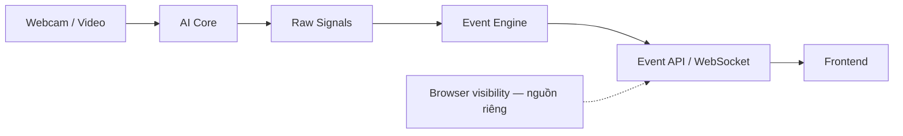

# Exam Monitoring System — Nhóm 3

Nền tảng phối hợp cho hệ thống ghi nhận **dấu hiệu hành vi quan sát được** qua webcam theo thời gian thực trong học tập/thi cử. Hệ thống hỗ trợ con người xem xét sự kiện; không tự kết luận gian lận, giảm tập trung, buồn ngủ hay ý định của người học.

Tên đề tài gốc: *Design and Development of an AI-Based System for Learning State Monitoring and Cheating Behavior Detection Support*. Tên lịch sử không phải cam kết rằng webcam đo được trạng thái tâm lý hoặc chứng minh gian lận.

## Trạng thái

Chỉ có cấu trúc repository, tài liệu phối hợp, schema **DRAFT** và payload tổng hợp. Chưa có AI inference, rule engine, REST API, database hay giao diện chạy được. Chưa chọn framework backend/frontend. Không có kết quả benchmark hoặc user study.

## Thành viên và cấu trúc

| Thư mục | Phụ trách | Trách nhiệm |
| --- | --- | --- |
| [ai-core/](ai-core/README.md) | Quyết | MediaPipe/OpenCV, trích xuất mắt/miệng/mặt/head pose, benchmark |
| [event-engine/](event-engine/README.md) | Huy | Quy tắc theo thời gian, evaluation và HCI |
| [backend/](backend/README.md) | Phúc | API, phân quyền, database, WebSocket |
| [frontend/](frontend/README.md) | Nam | UI/UX người học và giảng viên |
| [shared/schemas/](shared/schemas/README.md) | Quyết + Huy + Phúc | Contract DRAFT; Nam phản hồi nhu cầu UI |
| [shared/examples/](shared/examples/README.md) | Cả nhóm | Mock tổng hợp để làm việc độc lập |
| [docs/architecture/](docs/architecture/README.md) | Cả nhóm | Luồng dữ liệu, ranh giới trách nhiệm |
| [docs/api/](docs/api/README.md) | Phúc | Contract truyền dữ liệu DRAFT |
| [docs/evaluation/](docs/evaluation/README.md) | Huy | Kế hoạch đánh giá AI và HCI |
| [scripts/](scripts/README.md) | Cả nhóm | Kiểm tra nền tảng repository |
| .github/workflows/ | Cả nhóm | CI kiểm tra tài liệu và contract |

## Luồng dự kiến



Webcam là phạm vi ban đầu; camera giám sát/góc rộng là định hướng sau. Nhận diện điện thoại là tùy chọn theo WBS, chưa thuộc contract. Browser visibility chỉ mô tả trạng thái trang, không chứng minh người học dùng tài liệu ngoài.

## Bắt đầu

1. Đọc [CONTRIBUTING.md](CONTRIBUTING.md) và [quy tắc dữ liệu](docs/data-governance.md).
2. Chọn Task ID **đã có trong WBS**; tạo nhánh `feature/Txx-description` từ `main`.
3. Đọc README module; dùng [mock payload](shared/examples/README.md) mà không cần chạy module khác.
4. Kiểm tra bộ nền tảng (Python 3.12 là runtime cho công cụ kiểm tra, không phải quyết định runtime ứng dụng):

```bash
python3 -m venv .venv
. .venv/bin/activate
python -m pip install -r scripts/requirements-ci.txt
python scripts/validate_repository.py
```

Windows PowerShell: kích hoạt bằng `.venv\Scripts\Activate.ps1`.
Chưa cần `.env`; chỉ thêm `.env.example` không chứa bí mật khi module có cấu hình thực sự cần thiết.

## Tài liệu phối hợp

- [Kiến trúc và tích hợp](docs/architecture/README.md)
- [Taxonomy DRAFT](docs/architecture/event-taxonomy.md)
- [Đối chiếu WBS và tài liệu sản phẩm](docs/product-context.md)
- [Protocol HCI DRAFT](docs/evaluation/hci-protocol.md)
- [Quyết định cần xác nhận](docs/decisions-pending.md)
- [Đề xuất bảo vệ main](docs/repository-governance.md)
- [Danh sách file khởi tạo](docs/bootstrap-report.md)

Không commit secrets, video/ảnh người thật, thông tin cá nhân, dữ liệu nghiên cứu hoặc dataset nhạy cảm. Mock không phải dữ liệu thực nghiệm. Schema DRAFT phải được Quyết, Huy và Phúc thống nhất trước khi coi là chính thức.
